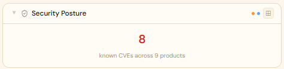
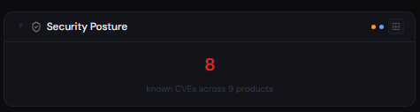
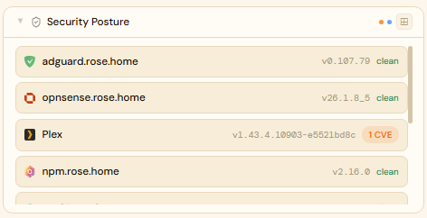
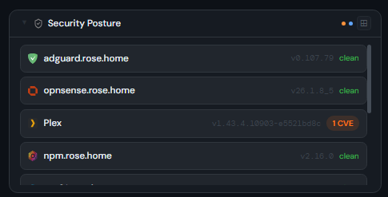
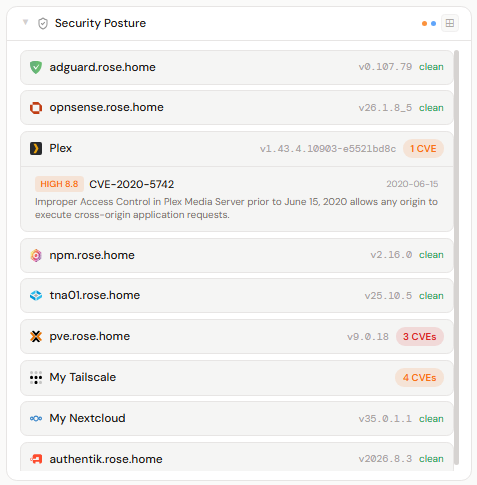
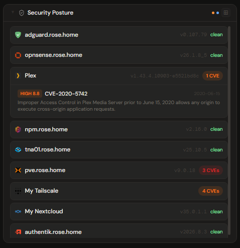

# Security Posture

## What is the Security Posture panel?

The Security Posture panel is a built-in Stoa panel that gives you an at-a-glance, **best-effort** view of published CVEs for some of the products you've connected to Stoa. For a curated set of covered integration types, it shows each one's detected running version next to CVEs pulled from the public [NVD](https://nvd.nist.gov/) (National Vulnerability Database). It is a quick prompt to go look at something — not a vulnerability scanner, and not an authoritative answer to "am I vulnerable?"

---

## Read this first: what it does and doesn't do

**What it does**

- Covers a **curated subset** of Stoa's integration types (24 of ~90 — listed below), not everything you run.
- Pulls each covered product's CVEs from the NVD once a day and lists them next to the version Stoa detected.
- For some products, makes a **best-effort** attempt to filter that list down to CVEs that apply to your running version, using version ranges recorded in NVD.
- Gives you a quick severity-colored summary so something worth a closer look stands out.

**What it doesn't do**

- **It is not a complete or authoritative CVE list.** It only knows what the NVD has published, only for covered products, and only as accurately as the NVD's own records.
- **It will show false positives.** CVEs that don't apply to your version — including ones patched long ago — can and do appear. The NVD's affected-version data is entered by many different people, is often incomplete, and is sometimes recorded in a form Stoa can't compare against a version number (see [Known limitations](#known-limitations)).
- **It will miss things.** Vulnerabilities that haven't been filed with the NVD yet, ones filed under a different product name, ones only disclosed in a vendor's own release notes, and anything in an uncovered product won't appear.
- **"Clean" does not mean safe.** It means nothing *matched* — see [What "clean" means](#what-clean-means).
- It doesn't scan your hosts, inspect running software, check configuration, or look at anything beyond the single version string Stoa already reads.
- It doesn't tell you whether an update is available.

**It is not meant to be the only place you check.** For anything that matters, confirm against the vendor's own security advisories and release notes. Treat every entry here as "worth a look," not as a confirmed finding — and treat the absence of an entry as "nothing surfaced here," not as an all-clear.

---

## Panel

**No integration or source picker required.** Every integration whose type is in the covered list *and that you can see* appears automatically — add a TrueNAS integration, and it shows up here on the next refresh. See [Access control](#access-control) for what "that you can see" means for a non-admin.

### How CVEs are matched

Each covered product uses one of two modes. Neither is precise; they differ in how much filtering is attempted.

- **Version-filtered mode (CPE).** For products whose NVD records are usually tagged with a product identifier ([CPE](https://nvd.nist.gov/products/cpe)) and affected-version ranges, Stoa fetches CVEs by that identifier and hides the ones whose recorded range clearly excludes your running version. This is only as good as the ranges NVD recorded:
  - If NVD recorded no range at all, or Stoa couldn't read your running version, the CVE is **shown and counted** — Stoa can't rule it out.
  - If NVD recorded the range in a form that can't be compared to a version number — most often a date (e.g. "fixed before 2020-06-15") — the CVE is **shown dimmed, marked "can't check against version", and left out of the counts and severity colors**. A row with only these shows "clean" plus a "+N unchecked" note; expand it to see them.
  - Either way, a CVE whose recorded range is simply *wrong* will be filtered wrongly, and any CVE never tagged with the product's identifier is missed entirely.
- **Keyword mode.** For everything else, CVEs are found by searching NVD descriptions for the product's name. This is broad and **version-blind**: Stoa does not try to decide whether your version is affected. It shows the product's CVEs next to your detected version and leaves the correlation to you. Expect noise — keyword matches can include CVEs that only mention the product in passing, and miss ones described under another name.

**Version-filtered (CPE):** OPNsense · Authentik · Traefik · Plex · Jellyfin · Grafana · Home Assistant

**Keyword:** TrueNAS · Unraid · OpenMediaVault · Synology · QNAP · Proxmox VE · pfSense · OpenWrt · Nginx Proxy Manager · Keycloak · Nextcloud · Omada Controller · UniFi Network · Pi-hole · AdGuard Home · Tailscale · Netbird

Which mode a product uses is a judgment call based on how consistently its NVD records carry usable version ranges. The list is deliberately small — products where a known vulnerability realistically matters (network-perimeter devices, auth systems, NAS/hypervisor platforms, apps commonly exposed to the internet), and that have meaningful NVD coverage at all. A few candidates (Gluetun, wg-easy, NextDNS) were dropped because the NVD has no CVEs filed against them, and "Cloudflare" was dropped because as a keyword it matches the company's entire product portfolio.

### Height behavior

| Height | What you see |
|---|---|
| 1x | Total counted CVEs across all covered integrations, colored by the worst severity present (unchecked CVEs excluded) |
| 2-3x | One row per covered integration: detected version and a CVE count badge (or "clean"), plus a "+N unchecked" note when some CVEs couldn't be checked against the version |
| 4x+ | Same list; click a row with CVEs to expand it into the CVE list (severity, CVSS score, description, publish date), each linking to its NVD detail page |

### Screenshots

| | Light | Dark |
|---|---|---|
| **1x** |  |  |
| **2x** |  |  |
| **4x** |  |  |

The screenshots were taken before unchecked CVEs were separated out, and show Plex flagged for CVE-2020-5742 — fixed in 2020 — against a current Plex build. NVD recorded that CVE's fix boundary as a date (`2020-06-15`) instead of a version number. Stoa now shows a CVE like that dimmed as "can't check against version" and doesn't count it, so that Plex row would read "clean · +1 unchecked". It's still a good illustration of how inconsistent NVD's data is: other CVEs with wrong or missing ranges will still show up as counted false positives.

---

## Known limitations

- **NVD data quality varies by product and by CVE.** Affected-version ranges are often missing, too broad, or recorded inconsistently. Some CVEs record the fix as a date, a build string, or not at all. Stoa can only compare dotted version numbers: a missing range is treated as "can't rule out" and counted; a date-shaped or unreadable range is shown dimmed as "can't check against version" and not counted.
- **Version detection is a single string per integration.** If Stoa can't read a version for an integration, version-filtered products show every CVE on file for that product. Tailscale and Netbird report the version shared by the most devices/peers on your network, which may not be the one on every device.
- **NVD publishing lag.** New CVEs can take days or longer to appear in the NVD with full details, and Stoa refreshes once a day on top of that.
- **Product naming.** Keyword mode only finds CVEs whose description uses the product name Stoa searches for. Rebrands, forks, and bundled components (a library inside the product) are easily missed.
- **OpenWrt and Omada version detection is unverified on real hardware** — see [How it works](#how-it-works).

### What "clean" means

A "clean" badge means **no counted CVEs matched** for that integration after filtering — not that the product has no vulnerabilities, and not that the product has no CVEs on file. For a version-filtered product, it means none of its CVEs had a recorded range that included your version — there may still be "unchecked" CVEs listed beside it that Stoa couldn't compare. For a keyword product with an ignore-date set, it means none were published after that date. Smaller self-hosted projects are often thinly tracked in CVE databases even when they patch real issues in their own release notes.

CVE data is held in memory and refreshed in the background. Until a product's CVE data has been fetched at least once — for a few minutes after Stoa restarts, or for longer if the NVD can't be reached — its row shows **"no CVE data yet"** instead of a count or "clean", and the 1x view notes how many products are still pending. A failed fetch is retried on the next hourly check. If a fetch fails after earlier ones succeeded, the last successful data keeps being shown.

---

## Access control

This panel auto-discovers integrations rather than referencing one you pick, so it uses the same visibility rule that governs "My Integrations" everywhere else in Stoa:

- Your own integrations (system or personal) always appear
- A system integration with no group restriction configured appears for everyone
- A system integration restricted to specific groups appears only if you're in one of those groups
- Non-admins never see another individual user's personal integrations; admins see all system integrations regardless of group restriction, but likewise don't see other users' personal integrations

Anyone can create a Security Posture panel, same as every other panel type. What's scoped is the *data*: if you share a Security Posture panel broadly, a viewer who can't see the underlying integrations will see fewer entries than you do, or an empty panel. That's deliberate — showing someone internal hostnames, exact software versions, and a matching CVE list for systems they have no access to would be an information leak. If a panel unexpectedly looks empty to someone you shared it with, the underlying integrations aren't shared to them — check the integration's group restrictions, not the panel's sharing.

---

## How it works

**Version detection** reads from data Stoa's integration workers already fetch for their normal panels — no extra call to the target app, with three exceptions: Authentik makes one small call to `/api/v3/admin/version/`, Nginx Proxy Manager calls its unauthenticated `/api/` status endpoint (its version comes back as separate major/minor/revision numbers and is assembled into e.g. `2.15.1`), and Keycloak calls `/admin/serverinfo`. Tailscale and Netbird are mesh VPNs with no single account-level version — each device/peer reports its own — so both report whichever version the most devices/peers share; Tailscale's value is truncated at its first dash to drop the build/commit suffix (`1.98.8-t1241b225b-gbcbaf1889` → `1.98.8`).

OpenWrt and Omada are wired in but **unverified against real hardware**:

- **OpenWrt** reads `release.version` from the `ubus call system board` RPC — the same call LuCI's status page uses for its firmware version. High confidence.
- **Omada** reads `controllerVer` from the unauthenticated `/api/v2/openapi/logininfo` call the login flow already uses. The field name comes from community/vendor documentation rather than a verified live response, so confidence is moderate.

Both log a debug line (`OPENWRT`/`OMADA` tags) if the expected field is missing. More generally, if a covered product's row has no version, check the backend logs for that product's tag (`TRUENAS`, `OPNSENSE`, etc.).

**CVE data** is fetched from the NVD API **once per product type** (not per integration) on a 24-hour cycle, and only for types you have at least one integration for. Requests are paced to stay well under the NVD's rate limit.

### NVD API key (optional)

Admin → Settings → NVD API Key. Works without one at the NVD's unauthenticated rate limit (5 requests per 30 seconds — plenty for a once-a-day refresh); a free key ([request one here](https://nvd.nist.gov/developers/request-an-api-key)) raises it to 50. Only worth setting if you see rate-limit errors in the logs.

### Cutting down keyword-mode noise: "Ignore CVEs before"

Keyword-mode integrations have an optional **Ignore CVEs before** date on their edit form (Admin/Profile → Integrations → edit). CVEs published before that date are hidden from that integration's row — count, badge color, and expanded list all reflect the filtered set. Version-filtered (CPE) products don't have this field; they rely on version ranges instead.

When Stoa notices a keyword-mode integration's version change (an upgrade or rollback), it sets this date to that day, on the reasoning that CVEs published before you upgraded are *likely* already patched. The first version Stoa ever sees is recorded without setting a date, since it can't know when that version was installed. You can change or clear the date at any time; Stoa only overwrites it on the next detected version change.

This is a coarse noise filter, not a correctness check: a CVE published before the date can still apply to you (vulnerabilities are sometimes filed years after the vulnerable code shipped), and one published after it may not. It's per-integration because different products update on very different schedules.

---

## Notes

- **CVSS severity colors:** Critical (red), High (orange), Medium (amber), Low (green-ish), Unknown (grey) — the standard CVSS bands. Severity is the NVD's base score for the CVE in general, not an assessment of your setup.
- **This is not "upgrade available" tracking.** It doesn't compare your version against a latest-release feed. For that, a container-registry watcher like [Diun](https://github.com/crazy-max/diun) is a better fit.
